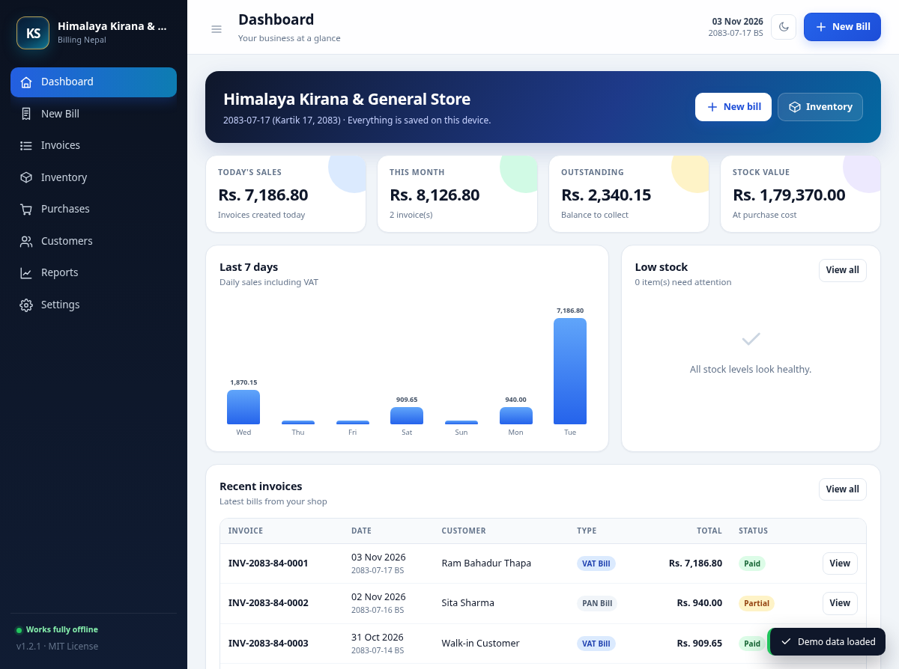
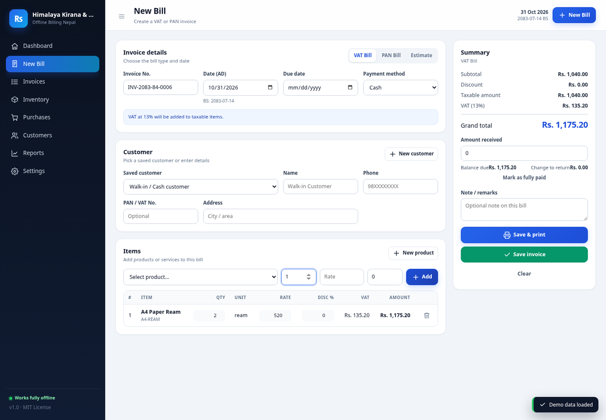
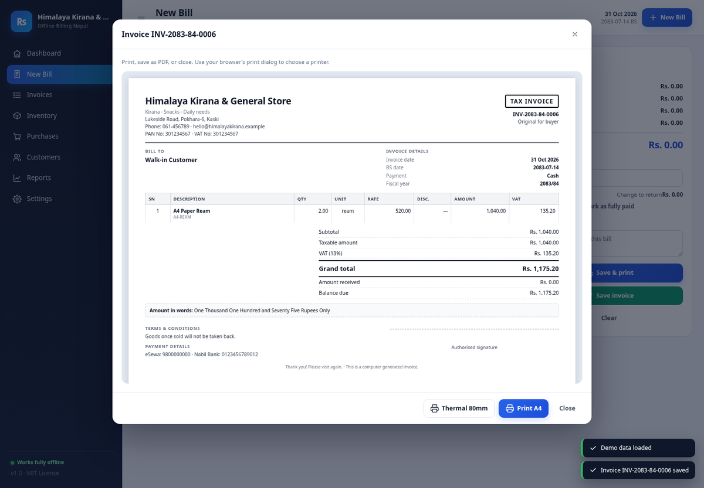
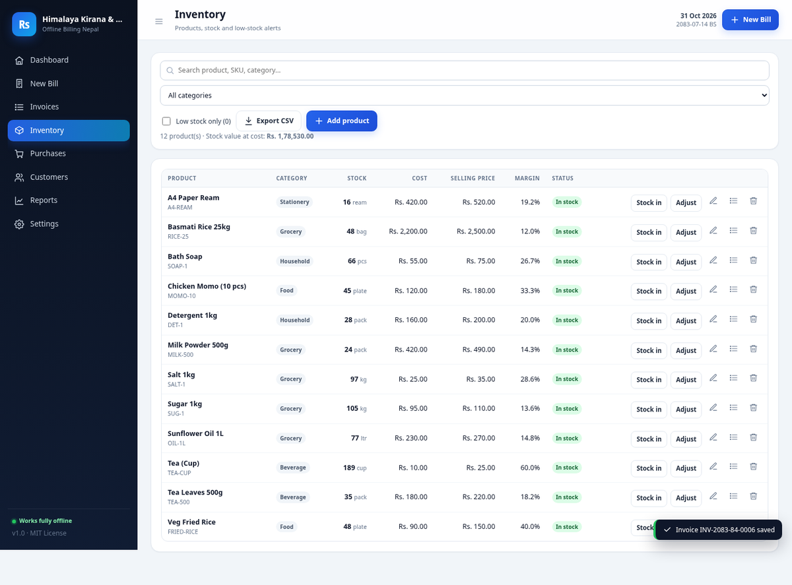
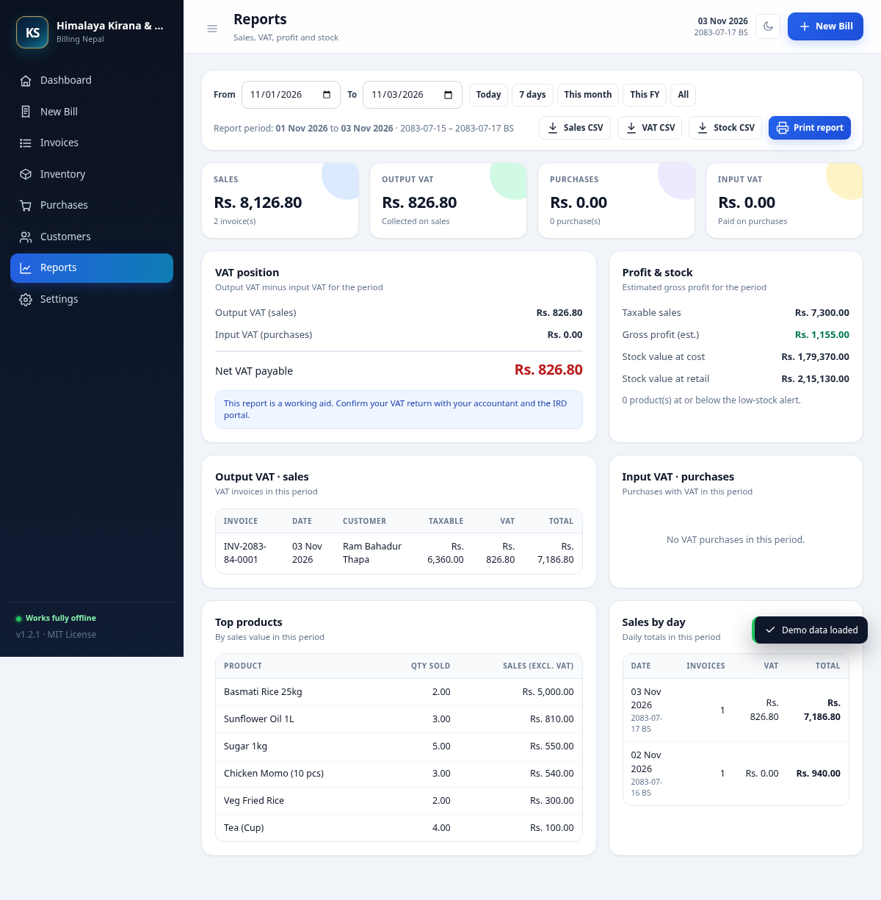
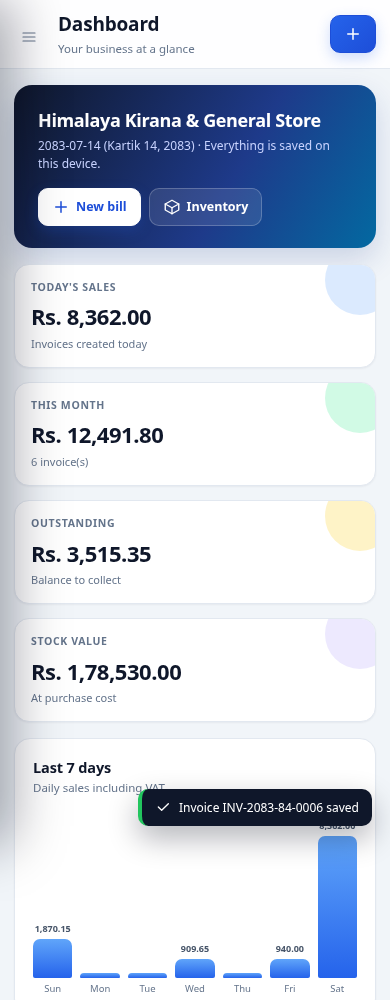

<p align="center">
  
</p>

<h1 align="center">Offline Billing Nepal</h1>

<p align="center">
  <strong>Free, fully offline billing, inventory and VAT/PAN invoicing for Nepal.</strong><br>
  One HTML file. No account. No subscription. No internet required. Your data stays on your device.
</p>

<p align="center">
  
  
  
  
</p>

<p align="center">
  <strong>Live app:</strong> <a href="https://kandelsarkar-lab.github.io/offline-billing-nepal/">https://kandelsarkar-lab.github.io/offline-billing-nepal/</a>
</p>

---

## Why this project?

Small businesses in Nepal often need a simple way to:

- create **VAT bills** and **PAN bills**,
- track **stock** without spreadsheets,
- record **purchases** from suppliers,
- see **sales, VAT and profit reports**,
- and keep working when the internet is down.

Most billing software is paid, requires a server, or needs an internet connection. **Offline Billing Nepal** is a single `index.html` file that runs in any modern browser. Copy it to a laptop, open it, and start billing.

It is designed for **kirana shops, hotels and restaurants, offices, companies, wholesalers, and service providers**.

> **No account. No server. No tracking. No monthly fee.**

## Features

### Billing

- **VAT Bill** — adds VAT (13% by default, configurable) to taxable items.
- **PAN Bill** — no VAT, useful for PAN-registered customers.
- **Estimate / Quotation** — does not deduct stock.
- Line-level quantity, rate and discount.
- Partial payments, balance due and change to return.
- Invoice numbering based on the **Bikram Sambat fiscal year** (e.g. `INV-2083-84-0001`).
- **AD and BS dates** on invoices.
- Amount in words using the Nepali/Indian numbering system (lakh, crore).
- **A4 invoice** and **80 mm thermal receipt** printing.
- Print or **Save as PDF** using the browser print dialog.
- Optional business logo, PAN/VAT numbers, bank details, terms and footer note.

### Inventory & stock

- Products and services with SKU, category, unit, cost and selling price.
- Stock quantity, low-stock alerts and stock value.
- **Purchases** from suppliers with VAT support.
- **Stock in**, **stock adjustments** and a full movement history.
- Weighted-average purchase cost for better profit estimates.
- Selling a service does not affect stock.

### Customers & suppliers

- Save name, phone, address, PAN and VAT number.
- Quick-select a customer while billing.
- See total business per customer or supplier.

### Reports

- Sales summary for any date range.
- **Output VAT** (sales) and **Input VAT** (purchases).
- **Net VAT payable / credit**.
- Estimated gross profit.
- Top products and daily sales.
- Stock value at cost and retail.
- Export **Sales CSV**, **VAT CSV** and **Stock CSV**.
- Print a clean A4 report.

### Mobile app & Excel

- Install on **Android** and **iPhone** home screens as a PWA.
- Works offline after the first load.
- Download **product** and **customer/supplier** CSV templates.
- Import data from **Excel or Google Sheets** by saving as CSV UTF-8.
- Export products and contacts back to CSV for editing or backup.
- Existing products with the same SKU or name are updated on import.

### Data & backup

- Data is stored in the browser's **localStorage** on your device.
- Export a **JSON backup** and restore it later.
- Load demo data to explore the app.
- Works from `file://`, a USB drive, or GitHub Pages.
- No backend, no database server, no cloud dependency.

### Interface

- Responsive layout for laptop, tablet and mobile.
- **Light and dark themes**, with a quick toggle in the top bar.
- Fast keyboard-friendly forms.
- Clean, modern UI with Nepal-specific dates, currency and number formatting.
- No external fonts, icons, CDNs or JavaScript libraries.

## Screenshots

| New bill | Invoice preview |
| --- | --- |
|  |  |

| Inventory | Reports |
| --- | --- |
|  |  |

<p align="center">
  <br>
  <sub>Mobile layout. <a href="screenshots/mobile-full.png">Open the full screenshot</a>.</sub>
</p>

## Quick start

### Option 1 — Download and open (simplest)

1. Download this repository as a ZIP, or clone it.
2. Open `index.html` in Chrome, Edge, Firefox or Safari.
3. Go to **Settings** and enter your business name, address, PAN/VAT numbers and logo.
4. Add products from **Inventory**.
5. Create your first bill from **New Bill**.

No installation, build step, or internet connection is required.

> On GitHub, you can also click the green **Code** button and choose **Download ZIP**.

### Option 2 — GitHub Pages (easy sharing)

1. Push this repository to GitHub.
2. Open **Settings → Pages**.
3. Under **Build and deployment → Source**, choose **GitHub Actions**.
4. The included workflow deploys the app automatically.
5. Share the Pages URL with your staff or customers.

The app will be available at:

```text
https://<your-username>.github.io/<repository-name>/
```

### Option 3 — Run a local server (optional)

Some browsers treat `file://` pages differently. If you prefer a local server:

```bash
python3 -m http.server 8080
```

Then open <http://localhost:8080>.

## Install on mobile

The hosted app can be installed on a phone home screen and used like a normal app.

**Live app:** <https://kandelsarkar-lab.github.io/offline-billing-nepal/>

### Android — Chrome

1. Open the live app in Chrome.
2. Tap the **three-dot menu**.
3. Tap **Add to Home screen** or **Install app**.
4. Confirm.

### iPhone — Safari

1. Open the live app in Safari.
2. Tap the **Share** button.
3. Scroll down and tap **Add to Home Screen**.
4. Tap **Add**.

After installation, open the app from the home screen. The app shell is cached by a service worker, so it keeps working offline after the first load.

> Your data is stored on the phone, in that browser. It does not sync automatically between devices. Use **Settings → Export backup** to move data.

See the full guide: [Mobile and Excel guide](docs/MOBILE_AND_EXCEL.md).

## Add data from Excel or CSV

You can bulk-add products and contacts using Excel, Google Sheets, or any spreadsheet app.

1. Open **Inventory → Download template** or **Customers → Download template**.
2. Fill the CSV file in Excel or Google Sheets.
3. Save it as **CSV UTF-8**.
4. Open **Inventory → Import Excel/CSV** or **Customers → Import Excel/CSV**.
5. Select the file and confirm the import.

Product columns:

```text
name,sku,category,unit,cost,price,stock,lowStock,vat,track
```

Customer/supplier columns:

```text
type,name,phone,address,pan,vat
```

- `type` can be `customer` or `supplier`.
- `vat` and `track` can be `yes` or `no`.
- Existing products are matched by **SKU or name**.
- Existing contacts are matched by **name and type**.
- Excel `.xlsx` files are not read directly. Save as **CSV UTF-8** first.

## How to use

### 1. Set up your business

Open **Settings** and fill in:

- business name, tagline and address,
- phone, email,
- PAN number and VAT number,
- invoice prefix (default `INV`),
- VAT rate (default `13`),
- currency symbol (default `Rs.`),
- bank/eSewa/Khalti payment details,
- terms and footer note.

Upload a logo if you have one. It is resized automatically and stored on your device.

### 2. Add products or services

Go to **Inventory → Add product**.

- Use **Track stock** for physical goods.
- Turn **Track stock** off for services such as consulting, tuition, room rent or repairs.
- Set a **low stock alert** level.
- Use **Stock in** for opening stock, returns or corrections.
- Use **Purchases** for proper supplier purchases with VAT.
- To add many products at once, download the CSV template and use **Import Excel/CSV**.

### 3. Add customers and suppliers

Go to **Customers** and use the **Customers** / **Suppliers** tabs.

- Add regular customers with their PAN/VAT numbers.
- Add suppliers for purchase records.
- You can still bill a walk-in customer without saving them.

### 4. Create a bill

Go to **New Bill**.

1. Choose **VAT Bill**, **PAN Bill** or **Estimate**.
2. Check the invoice number and date.
3. Select a saved customer or type a walk-in name.
4. Select a product, enter quantity, rate and discount, then click **Add**.
5. Enter the amount received, or click **Mark as fully paid**.
6. Click **Save & print** or **Save invoice**.

Stock is deducted automatically for VAT and PAN bills. Estimates do not change stock.

### 5. Record purchases

Go to **Purchases → New purchase**.

- Choose the supplier.
- Add the items and purchase cost.
- Tick **Include VAT** if the supplier charged VAT.
- Save. Stock and weighted-average cost are updated automatically.

### 6. Check reports

Go to **Reports**.

- Use the date presets or choose a custom range.
- Review sales, output VAT, input VAT, net VAT and estimated profit.
- Export CSV files for your accountant.
- Print the report for your records.

### 7. Back up your data

Go to **Settings → Backup & restore → Export backup**.

Keep the JSON file somewhere safe. Browser data can be deleted when you clear browsing data, reset the browser, or change computers.

To restore, open **Settings → Import backup** and select the JSON file.

For a detailed walkthrough, see the [User Guide](docs/USER_GUIDE.md).

## VAT and PAN in Nepal

- The default VAT rate is **13%** and can be changed in Settings.
- A **VAT Bill** adds VAT to taxable line items.
- A **PAN Bill** does not charge VAT.
- An **Estimate** is a quotation and does not deduct stock.
- Invoice numbers include the **Bikram Sambat fiscal year**, for example `INV-2083-84-0001`.
- The app shows both **AD and BS dates** on invoices.
- The VAT report is a working aid. Always verify your return with your accountant and the **Inland Revenue Department (IRD)**.

> **Important:** Some VAT-registered businesses in Nepal are required to use IRD-approved billing software. This project is a free, general-purpose billing tool, not an IRD-certified billing system. Check your legal obligations before using it for statutory invoices.

## Printing

### A4 invoice

Open any invoice and click **Print A4**. In the browser print dialog:

- choose your printer or **Save as PDF**,
- set paper size to **A4**,
- enable **Background graphics** if you want the table shading,
- set margins to **Default** or **Minimum**.

### Thermal 80 mm receipt

Open an invoice and click **Thermal 80mm**.

- Set paper size to **80 mm** (or your printer's roll width).
- Disable headers and footers in the print dialog.
- Set margins to **None** or **Minimum**.

> If the thermal layout looks too wide, choose "Fit to page" or reduce the scale in the print dialog.

## Data, privacy and backup

- All data is stored in **localStorage** in your browser.
- Nothing is uploaded to a server.
- There is no analytics, tracking, login or cloud sync.
- Data is tied to the browser and device. Opening the file in a different browser shows a different data store.
- Clearing browser data, using private/incognito mode, or changing devices can remove your data.
- **Export a JSON backup regularly**, especially before updating the app or changing computers.
- CSV imports are processed entirely on your device. No file is uploaded anywhere.
- On mobile, the installed app uses the same browser storage. Clearing the browser/app data deletes it, so keep a backup.
- For a shared shop computer, keep a backup on a USB drive or in your own cloud storage.

## Technology

- **Single app file:** `index.html` contains all HTML, CSS and application JavaScript.
- **PWA support:** `manifest.webmanifest`, `sw.js` and `icons/` enable installation and offline caching.
- **Vanilla JavaScript** — no React, Vue, jQuery or build tools.
- **localStorage** for persistence.
- **Inline SVG** icons — no icon fonts or CDNs.
- **Bikram Sambat calendar data** embedded for AD ↔ BS conversion.
- **No runtime dependencies** and no third-party network requests. The service worker caches the app shell for offline use.

The app has been tested in Chromium on desktop and mobile viewports. Core flows tested include billing, PAN/VAT totals, estimates, stock deduction/restoration, purchases, payments, reports, CSV export, backup/restore and printing.

## Project structure

```text
.
├── index.html                  # The entire application
├── manifest.webmanifest        # PWA install metadata
├── sw.js                       # Offline service worker
├── icons/                      # App icons for mobile install
├── README.md                   # This file
├── README.np.md                # Nepali quick guide
├── LICENSE                     # MIT License
├── CONTRIBUTING.md             # How to contribute
├── CODE_OF_CONDUCT.md          # Community guidelines
├── CHANGELOG.md                # Release notes
├── .editorconfig               # Editor formatting rules
├── .gitignore                  # Files Git should ignore
├── docs/
│   ├── USER_GUIDE.md           # Step-by-step user guide
│   └── MOBILE_AND_EXCEL.md     # Mobile install and CSV import guide
├── screenshots/                # Screenshots used in the README
└── .github/
    ├── ISSUE_TEMPLATE/         # Bug and feature request forms
    ├── pull_request_template.md
    └── workflows/pages.yml     # GitHub Pages deployment
```

## Contributing

Contributions are welcome. You can help by:

- reporting bugs with steps to reproduce,
- suggesting features for Nepali businesses,
- improving the Nepali translation and labels,
- testing on different browsers and printers,
- improving the documentation,
- sharing the project with a shop that needs it.

Please read [CONTRIBUTING.md](CONTRIBUTING.md) before opening a pull request.

### Good first issues

- Add a Nepali UI language toggle.
- Add barcode/QR scanning for products.
- Add a customer credit ledger.
- Add purchase returns and sales returns.
- Add multi-store support.
- Add e-invoice / IRD-compatible export (only with proper research).
- Improve thermal printer compatibility.
- Add more automated tests.

## Roadmap

- [x] VAT and PAN bills
- [x] Inventory, purchases and stock adjustments
- [x] A4 and thermal printing
- [x] AD/BS dates and fiscal-year invoice numbers
- [x] Reports and CSV export
- [x] JSON backup and restore
- [x] Responsive UI
- [x] Mobile install (PWA)
- [x] Excel/CSV import for products and contacts
- [ ] Nepali UI language toggle
- [ ] Barcode scanning
- [ ] Customer credit ledger
- [ ] Sales/purchase returns
- [ ] Optional encrypted cloud backup (bring your own storage)

## License

This project is released under the **MIT License**. See [LICENSE](LICENSE).

You can use it, modify it, share it, and use it commercially for free. Attribution is appreciated but not required.

## Disclaimer

This software is provided "as is", without warranty of any kind. The authors are not responsible for data loss, incorrect tax calculations, or legal compliance issues. Always keep backups and verify tax figures with a qualified accountant.

---

<p align="center">
  Made with ❤️ for Nepal.<br>
  If this project helps your business, please ⭐ star the repository and share it.
</p>
