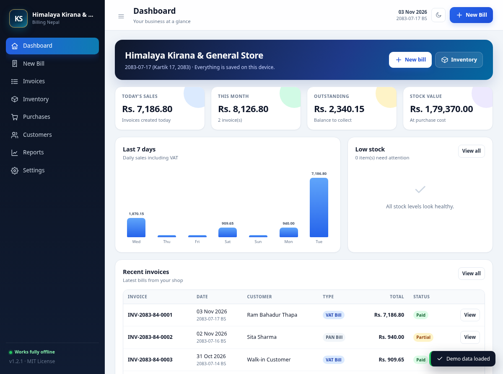

<p align="center">
  
</p>

<h1 align="center">बिलिङ नेपाल</h1>

<p align="center">
  
</p>

<p align="center">
  <strong>नेपालका साना व्यवसायका लागि पूर्ण अफलाइन, निःशुल्क बिलिङ, स्टक र भ्याट/प्यान इन्भ्वाइसिङ।</strong><br>
  एउटै HTML फाइल। खाता वा सदस्यता चाहिँदैन। इन्टरनेट चाहिँदैन। डाटा तपाईंको यन्त्रमै रहन्छ।
</p>

<p align="center">
  
  
  
</p>

<p align="center">
  <strong>प्रत्यक्ष एप:</strong> <a href="https://kandelsarkar-lab.github.io/offline-billing-nepal/">https://kandelsarkar-lab.github.io/offline-billing-nepal/</a>
</p>

---

## यो के हो?

**बिलिङ नेपाल** एउटा निःशुल्क बिलिङ एप हो, जुन एउटै `index.html` फाइलमा चल्छ। किराना पसल, होटल तथा रेस्टुरेन्ट, अफिस, कम्पनी, होलसेल र सेवा व्यवसायीले प्रयोग गर्न सक्नुहुन्छ।

- भ्याट बिल र प्यान बिल बनाउनुहोस्
- स्टक र इन्भेन्टरी व्यवस्थापन गर्नुहोस्
- आपूर्तिकर्ताबाट खरिद (purchase) रेकर्ड गर्नुहोस्
- ग्राहक र आपूर्तिकर्ताको विवरण सुरक्षित राख्नुहोस्
- बिक्री, भ्याट, नाफा र स्टक रिपोर्ट हेर्नुहोस्
- A4 वा 80mm थर्मल प्रिन्टरमा बिल प्रिन्ट गर्नुहोस्
- इन्टरनेट नभएपनि काम गर्नुहोस्

> कुनै खाता चाहिँदैन। कुनै सर्भर चाहिँदैन। कुनै मासिक शुल्क चाहिँदैन। कुनै ट्र्याकिङ छैन।

## मुख्य सुविधाहरू

### बिलिङ

- **भ्याट बिल** — १३% भ्याट (सेटिङबाट परिवर्तन गर्न सकिने)।
- **प्यान बिल** — भ्याट नलाग्ने बिल।
- **इस्टिमेट / कोटेसन** — स्टक घट्दैन।
- **किबोर्डबाट उत्पादन खोज्ने** — स्क्रोल नगरी नाम, SKU वा category टाइप गर्नुहोस्; arrow keys र Enter पनि चल्छ।
- प्रत्येक सामानको परिमाण, दर र छुट।
- आंशिक भुक्तानी, बाँकी रकम र फिर्ता दिनुपर्ने पैसा।
- **विक्रम सम्वत् आर्थिक वर्ष** अनुसार बिल नम्बर (जस्तै `INV-2083-84-0001`)।
- बिलमा **ईस्वी र विक्रम सम्वत्** दुवै मिति।
- नेपाली/भारतीय अंक प्रणाली अनुसार रकम अक्षरमा (लाख, करोड)।
- **A4 बिल** र **80mm थर्मल रिसिप्ट**।
- ब्राउजरको प्रिन्टबाट **PDF** मा सेभ गर्न सकिने।
- लोगो, प्यान/भ्याट नम्बर, बैंक विवरण, सर्त र फुटर नोट।

### स्टक तथा इन्भेन्टरी

- सामान र सेवाको नाम, SKU, वर्ग, एकाइ, लागत र बिक्री मूल्य।
- स्टक परिमाण, कम स्टक चेतावनी र स्टक मूल्य।
- आपूर्तिकर्ताबाट **खरिद** (भ्याट सहित)।
- **स्टक इन**, **स्टक समायोजन** र पूरा स्टक इतिहास।
- बिक्री गर्दा स्टक स्वतः घट्ने; इस्टिमेटमा नघट्ने।
- सेवाको हकमा स्टक ट्र्याक बन्द गर्न सकिने।

### ग्राहक र आपूर्तिकर्ता

- नाम, फोन, ठेगाना, प्यान र भ्याट नम्बर सुरक्षित राख्नुहोस्।
- बिल बनाउँदा सजिलै छान्नुहोस्।
- प्रत्येक ग्राहक/आपूर्तिकर्ताको कुल कारोबार हेर्नुहोस्।

### रिपोर्ट

- कुनै पनि मिति अवधिको बिक्री रिपोर्ट।
- **आउटपुट भ्याट** (बिक्री) र **इनपुट भ्याट** (खरिद)।
- **तिर्नुपर्ने वा क्रेडिट भ्याट**।
- अनुमानित कुल नाफा।
- धेरै बिक्री भएका सामान र दैनिक बिक्री।
- लागत र बिक्री मूल्य अनुसार स्टक मूल्य।
- **Sales CSV**, **VAT CSV** र **Stock CSV** निर्यात।
- A4 रिपोर्ट प्रिन्ट।

### मोबाइल र Excel/CSV

- Android र iPhone को होम स्क्रिनमा **PWA** को रूपमा इन्स्टल गर्न सकिने।
- पहिलो पटक खोलेपछि इन्टरनेट बिना पनि चल्ने।
- सामान र ग्राहक/आपूर्तिकर्ताको **CSV टेम्प्लेट** डाउनलोड।
- Excel वा Google Sheets बाट **CSV UTF-8** मा सेभ गरेर बल्क डाटा आयात।
- सामान र सम्पर्कहरू CSV मा निर्यात गरेर सम्पादन वा ब्याकअप गर्न सकिने।
- एउटै SKU वा नाम भएका सामान आयात गर्दा अपडेट हुने।

### डाटा र ब्याकअप

- डाटा ब्राउजरको **localStorage** मा तपाईंको यन्त्रमै रहन्छ।
- **JSON ब्याकअप** निर्यात र पुनःस्थापना।
- डेमो डाटा लोड गरेर एप चलाएर हेर्न सकिने।
- `file://`, USB ड्राइभ वा GitHub Pages बाट चल्ने।
- कुनै सर्भर, डाटाबेस वा क्लाउड आवश्यक छैन।
- **Light / Dark theme** — **Settings → Appearance** वा माथिको moon/sun बटनबाट।

## सुरु गर्ने तरिका

### १. डाउनलोड गरेर खोल्नुहोस्

1. यो रिपोजिटरी ZIP मा डाउनलोड गर्नुहोस् वा क्लोन गर्नुहोस्।
2. `index.html` फाइल Chrome, Edge, Firefox वा Safari मा खोल्नुहोस्।
3. **Settings** मा गएर व्यवसायको नाम, ठेगाना, प्यान/भ्याट नम्बर र लोगो राख्नुहोस्।
4. **Inventory** बाट सामान थप्नुहोस्।
5. **New Bill** बाट पहिलो बिल बनाउनुहोस्।

इन्स्टल वा बिल्ड आवश्यक छैन; मोबाइलमा चाहे होम स्क्रिनमा इन्स्टल गर्न सकिन्छ।

### २. GitHub Pages बाट सबैलाई उपलब्ध गराउनुहोस्

1. यो रिपोजिटरी GitHub मा पुश गर्नुहोस्।
2. **Settings → Pages** खोल्नुहोस्।
3. **Source** मा **GitHub Actions** छान्नुहोस्।
4. दिइएको workflow ले एप स्वतः deploy गर्छ।
5. बनेको लिंक स्टाफ वा ग्राहकसँग सेयर गर्नुहोस्।

### ३. स्थानीय सर्भर (वैकल्पिक)

```bash
python3 -m http.server 8080
```

त्यसपछि <http://localhost:8080> खोल्नुहोस्।

## मोबाइलमा इन्स्टल गर्ने

GitHub Pages को लिंक फोनमा खोलेर होम स्क्रिनमा इन्स्टल गर्न सकिन्छ।

### Android — Chrome

1. लिंक **Chrome** मा खोल्नुहोस्।
2. माथि दायाँको **तीन थोप्ला (⋮)** मेनु थिच्नुहोस्।
3. **Add to Home screen** वा **Install app** थिच्नुहोस्।
4. पुष्टि गर्नुहोस्।

### iPhone — Safari

1. लिंक **Safari** मा खोल्नुहोस्।
2. **Share** बटन थिच्नुहोस्।
3. तल स्क्रोल गरेर **Add to Home Screen** थिच्नुहोस्।
4. **Add** थिच्नुहोस्।

इन्स्टल गरेपछि होम स्क्रिनबाट खोल्नुहोस्। पहिलो पटक खोलेपछि एप इन्टरनेट बिना पनि चल्छ। डाटा त्यही फोनको ब्राउजरमा रहन्छ; स्वतः सिंक हुँदैन। एपभित्र **Settings → Mobile app** मा पनि यही निर्देशन पाइन्छ।

## Excel/CSV बाट डाटा थप्ने

धेरै सामान वा सम्पर्क एकैचोटि थप्न Excel, Google Sheets वा LibreOffice Calc प्रयोग गर्न सकिन्छ।

### सामान

1. **Inventory** खोल्नुहोस्।
2. **Download template** थिच्नुहोस्।
3. CSV फाइलमा डाटा भर्नुहोस्।
4. **CSV UTF-8** मा सेभ गर्नुहोस्।
5. **Import Excel/CSV** थिचेर फाइल छान्नुहोस्।

सामानको कोलम:

```text
name,sku,category,unit,cost,price,stock,lowStock,vat,track
```

- `name` अनिवार्य छ।
- `vat` र `track` मा `yes` वा `no` राख्नुहोस्।
- सेवाको हकमा `track` मा `no` राख्नुहोस्।
- एउटै **SKU वा नाम** भएको सामान अपडेट हुन्छ।
- स्टक परिवर्तन भएमा स्टक इतिहासमा समायोजन रेकर्ड हुन्छ।

### ग्राहक र आपूर्तिकर्ता

1. **Customers** खोल्नुहोस्।
2. **Download template** थिच्नुहोस्।
3. CSV फाइल भर्नुहोस्।
4. **CSV UTF-8** मा सेभ गर्नुहोस्।
5. **Import Excel/CSV** थिचेर फाइल छान्नुहोस्।

सम्पर्कको कोलम:

```text
type,name,phone,address,pan,vat
```

- `type` मा `customer` वा `supplier` राख्नुहोस्।
- एउटै **नाम र प्रकार** भएको सम्पर्क अपडेट हुन्छ।

Excel को `.xlsx` फाइल सिधै पढिँदैन। पहिले **CSV UTF-8** मा सेभ गर्नुहोस्। विस्तृत निर्देशन: [Mobile and Excel guide](docs/MOBILE_AND_EXCEL.md)।

## कसरी प्रयोग गर्ने?

### व्यवसाय सेटअप

**Settings** मा गएर:

- व्यवसायको नाम, ट्यागलाइन र ठेगाना
- फोन र इमेल
- प्यान नम्बर र भ्याट नम्बर
- बिल प्रिफिक्स (डिफल्ट `INV`)
- भ्याट दर (डिफल्ट `१३%`)
- मुद्रा चिन्ह (डिफल्ट `Rs.`)
- बैंक / eSewa / Khalti विवरण
- सर्त र फुटर नोट

भरेर **Save settings** थिच्नुहोस्।

### सामान थप्ने

**Inventory → Add product** मा गएर:

- सामानको नाम, SKU, वर्ग, एकाइ
- खरिद लागत र बिक्री मूल्य
- सुरुको स्टक र कम स्टक चेतावनी
- **Apply VAT** र **Track stock** विकल्प

सेवाको हकमा **Track stock** बन्द गर्नुहोस्।

### बिल बनाउने

**New Bill** मा गएर:

1. **VAT Bill**, **PAN Bill** वा **Estimate** छान्नुहोस्।
2. बिल नम्बर र मिति जाँच्नुहोस्।
3. ग्राहक छान्नुहोस् वा नाम लेख्नुहोस्।
4. सामान छानेर परिमाण, दर र छुट हाल्नुहोस्।
5. **Add** थिच्नुहोस्।
6. प्राप्त रकम हाल्नुहोस् वा **Mark as fully paid** थिच्नुहोस्।
7. **Save & print** वा **Save invoice** थिच्नुहोस्।

भ्याट र प्यान बिलमा स्टक स्वतः घट्छ। इस्टिमेटमा स्टक घट्दैन।

### खरिद रेकर्ड गर्ने

**Purchases → New purchase** मा गएर:

- आपूर्तिकर्ता छान्नुहोस्।
- सामान, परिमाण र खरिद दर हाल्नुहोस्।
- भ्याट लागेको भए **Include VAT** छान्नुहोस्।
- **Save purchase** थिच्नुहोस्।

स्टक र औसत लागत स्वतः अपडेट हुन्छ।

### ब्याकअप

**Settings → Backup & restore → Export backup** मा गएर JSON फाइल सेभ गर्नुहोस्।

ब्राउजरको डाटा मेटिएमा, ब्राउजर फेरेमा वा नयाँ कम्प्युटरमा सर्दा यो फाइलबाट **Import backup** गरेर डाटा फर्काउन सकिन्छ।

## भ्याट र प्यान

- डिफल्ट भ्याट दर **१३%** हो; Settings बाट परिवर्तन गर्न सकिन्छ।
- **भ्याट बिल** मा भ्याट लाग्ने सामानमा भ्याट जोडिन्छ।
- **प्यान बिल** मा भ्याट लाग्दैन।
- **इस्टिमेट** कोटेसन हो; स्टक घट्दैन।
- बिल नम्बरमा **विक्रम सम्वत् आर्थिक वर्ष** समावेश हुन्छ।
- बिलमा **ईस्वी र विक्रम सम्वत्** दुवै मिति देखिन्छ।

> **ध्यान दिनुहोस्:** केही भ्याट दर्ता भएका व्यवसायले IRD-स्वीकृत बिलिङ सफ्टवेयर प्रयोग गर्नुपर्ने हुनसक्छ। यो एप सामान्य बिलिङका लागि बनाइएको निःशुल्क औजार हो, IRD-प्रमाणित बिलिङ प्रणाली होइन। करको अन्तिम हिसाब आफ्नो लेखापालसँग मिलाएर गर्नुहोस्।

## प्रिन्ट

### A4 बिल

कुनै बिल खोलेर **Print A4** थिच्नुहोस्। प्रिन्ट डायलगमा:

- प्रिन्टर वा **Save as PDF** छान्नुहोस्
- कागजको साइज **A4** राख्नुहोस्
- आवश्यक भए **Background graphics** खोल्नुहोस्

### 80mm थर्मल रिसिप्ट

बिल खोलेर **Thermal 80mm** थिच्नुहोस्।

- कागजको साइज **80 mm** राख्नुहोस्
- Header/footer बन्द गर्नुहोस्
- Margin **None** वा **Minimum** राख्नुहोस्

## डाटा र गोपनीयता

- सबै डाटा ब्राउजरको **localStorage** मा रहन्छ।
- कुनै डाटा सर्भरमा पठाइँदैन।
- कुनै analytics, tracking वा लगइन छैन।
- डाटा ब्राउजर र यन्त्रसँग बाँधिएको हुन्छ।
- ब्राउजरको डाटा मेटाउँदा, incognito प्रयोग गर्दा वा यन्त्र फेर्दा डाटा जानसक्छ।
- CSV आयात तपाईंको यन्त्रमै प्रशोधन हुन्छ; कुनै फाइल सर्भरमा पठाइँदैन।
- मोबाइलमा इन्स्टल गरेपछि पनि ब्राउजर/एप डाटा मेटाउँदा डाटा जानसक्छ।
- **नियमित रूपमा JSON ब्याकअप लिनुहोस्।**

## प्रविधि

- एउटै `index.html` फाइलमा HTML, CSS र एपको JavaScript।
- **PWA** का लागि `manifest.webmanifest`, `sw.js` र `icons/`।
- कुनै framework, build tool वा CDN छैन।
- localStorage मा डाटा।
- AD ↔ BS मिति रूपान्तरणको लागि विक्रम सम्वत् क्यालेन्डर डाटा भित्रै।
- इन्टरनेट बिना पनि पूर्ण रूपमा चल्छ।

## थप दस्तावेज

- अंग्रेजी विस्तृत गाइड: [docs/USER_GUIDE.md](docs/USER_GUIDE.md)
- मोबाइल इन्स्टल र Excel/CSV गाइड: [docs/MOBILE_AND_EXCEL.md](docs/MOBILE_AND_EXCEL.md)
- अंग्रेजी मुख्य README: [README.md](README.md)

## योगदान

योगदान स्वागत छ। बग रिपोर्ट गर्न, नयाँ सुविधा सुझाव दिन, नेपाली भाषा सुधार गर्न, फरक ब्राउजर/प्रिन्टरमा परीक्षण गर्न वा दस्तावेज सुधार गर्न सक्नुहुन्छ।

थप विवरण: [CONTRIBUTING.md](CONTRIBUTING.md)

## लाइसेन्स

यो परियोजना **MIT License** अन्तर्गत निःशुल्क छ। विस्तृत विवरण: [LICENSE](LICENSE)

## अस्वीकरण

यो सफ्टवेयर "जस्तो छ त्यस्तै" उपलब्ध गराइएको छ। डाटा हानि, गलत कर गणना वा कानुनी असमझदारीको जिम्मेवारी लेखकको हुँदैन। ब्याकअप राख्नुहोस् र करको हिसाब लेखापालसँग जाँच्नुहोस्।

---

<p align="center">
  नेपालका लागि ❤️ सहित।<br>
  यो परियोजना उपयोगी लागे ⭐ star गर्नुहोस् र अरूलाई पनि सेयर गर्नुहोस्।
</p>
